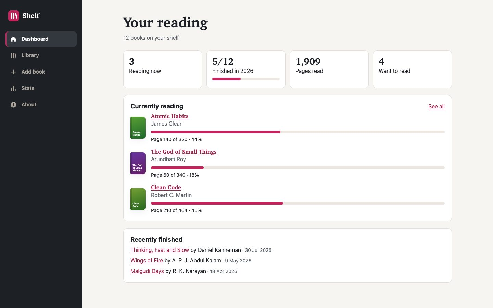

# Shelf — Single Page Application

Week 5 project for the Frontend Web Developer Internship: **Developing a Single Page Application (SPA) Simulation**.

Shelf is a small reading tracker. One HTML page acts as the container, and JavaScript renders every view (dashboard, library, book pages, add form, stats, about and fallbacks) into it. Moving between views never reloads the page, while the URL, browser history and page title stay in step with what is on screen.



## Assignment objective

Simulate an SPA that loads content dynamically without full page reloads: structure the app, use JavaScript to manage browser history, the URL and the DOM, keep transitions smooth, handle errors, and document the architecture and challenges.

## Features

- **Hash-based client-side router**: route parameters (`#/book/:id`), query strings (`#/library?status=reading&q=…&sort=…`), trailing-slash and malformed-URL handling, and a 404 fallback
- **Browser history**: links push entries; typing in search and changing sort use `replaceState`; Back and Forward work without reloads
- **Refresh and direct links** work for every route on any static server
- **State management**: a store with loading/ready/error status, business rules, `localStorage` persistence (sanitised on load) and a reset
- **Dynamic views** built from data, never hidden static sections
- **Loading, empty and error states**, including a Try again button if `data/books.json` fails to load
- **Transitions**: 180 ms fade-in per view, turned off under `prefers-reduced-motion`
- **Accessibility**: focus moves to each new page heading, `aria-current` on navigation, a JavaScript skip link that does not break routing, native controls, a modal `<dialog>` for deletes, live-region toasts
- **Responsive**: bottom tab bar on phones, sidebar from 60em

| Route | View |
|-------|------|
| `#/` | Dashboard |
| `#/library?status=&q=&sort=` | Library (filters in the URL) |
| `#/book/:id` | Book details, progress, rating, notes, delete |
| `#/add` | Add a book |
| `#/stats` | Goal and statistics |
| `#/about` | About and reset |
| anything else | Page not found / Book not found |

## Technologies

HTML5, CSS3, vanilla JavaScript ES modules, plus browser APIs: `hashchange`, `history.replaceState`, `fetch`, `URLSearchParams`, `localStorage`, `<dialog>`. No frameworks or runtime libraries. Dev-only: Node's test runner, Puppeteer + Google Chrome, html-validate, csstree-validator.

## Project structure

```
week-5-single-page-application/
├── index.html              app shell with <main id="view">
├── css/styles.css
├── js/main.js              entry point: store + router + routes
├── js/router.js            hash router
├── js/store.js             state, loading, persistence
├── js/dom.js, js/ui.js     DOM helpers, toasts, confirm dialog
├── js/views/               one module per view
├── data/books.json         sample data (fetched on first run)
├── assets/favicon.svg
├── tests/spa.test.mjs      14 end-to-end tests
├── tests/screenshots.mjs
├── docs/screenshots/
├── report.docx
├── README.md
├── TESTING.md
└── week-5-single-page-application.zip
```

## Run it

The app uses ES modules and `fetch`, which browsers block on `file://` pages, so serve the folder:

```bash
python3 -m http.server 8000
```

then open <http://localhost:8000/>. (`npm start` runs the same command.) Opening `index.html` directly shows a message explaining this.

## Test it

Requires Node.js 18+ and Google Chrome (`CHROME_PATH` overrides the default macOS path).

```bash
npm install
npm test               # validation + 14 end-to-end tests
npm run screenshots    # regenerate docs/screenshots
npm run zip            # rebuild week-5-single-page-application.zip (excludes .git and node_modules)
```

See [TESTING.md](TESTING.md).

## Implementation notes

- If only the query string changes on the same route, the router calls the view's `update()` instead of re-rendering, so the search box keeps focus.
- A router guard shows the loading or error view until the data is ready; then `router.refresh()` draws whatever route is in the address, which is why direct links work on first load.
- Text is always inserted with text nodes (`el()` helper), never as HTML.
- Saved data is sanitised: malformed books are dropped and numbers are clamped.

## Known limitations

- Hash URLs (`#/book/3`). Clean path URLs would need a server fallback rule that static hosts like GitHub Pages do not provide.
- Must be served over HTTP(S), not opened from `file://`.
- Scroll position is reset to the top on every navigation, including Back.
- Data is stored per browser; there is no backend.
- Tested in Chromium only (headless Chrome and the Claude desktop app's browser pane).
